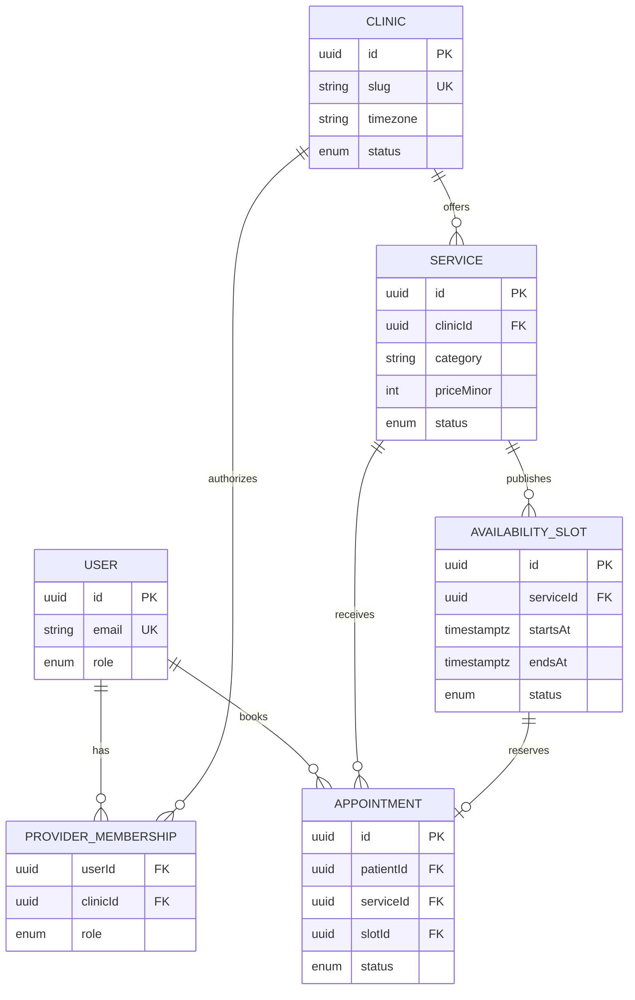

# AffordableCare Backend and Database Architecture

**Primary owners:** Chioma Asiama (`enyinne`) and Preston Machanga (`Press2027`)  
**Frontend contract owner:** Victor Patrick (`DjPatbern`)  
**Database decision:** PostgreSQL with Prisma ORM

This document is the implementation handoff for the database, API, authentication, authorization, and booking foundations. PostgreSQL is selected because the application depends on strong relationships, transactions, uniqueness constraints, and conflict-safe appointment booking.

## Core entities

### 1. User

| Field | Type | Notes |
| --- | --- | --- |
| `id` | UUID | Primary key |
| `email` | string | Unique, normalized |
| `name` | string | Display name |
| `phone` | string? | Optional patient contact |
| `role` | enum | `PATIENT`, `PROVIDER`, or `ADMIN` |
| `createdAt` / `updatedAt` | timestamp | Audit timestamps |

### 2. Clinic

| Field | Type | Notes |
| --- | --- | --- |
| `id` | UUID | Primary key |
| `name` | string | Public clinic name |
| `slug` | string | Unique public identifier |
| `description` | text | Public overview |
| `addressLine1`, `city`, `region`, `country` | string | Searchable location |
| `phone`, `email` | string | Public contact details |
| `timezone` | string | IANA timezone such as `Africa/Lagos` |
| `status` | enum | `DRAFT`, `PUBLISHED`, `SUSPENDED` |
| `createdAt` / `updatedAt` | timestamp | Audit timestamps |

Providers manage clinics through a supporting `ProviderMembership` join record containing `userId`, `clinicId`, `role`, and timestamps. This enables many providers per clinic and a provider to work across clinics.

### 3. Service

| Field | Type | Notes |
| --- | --- | --- |
| `id` | UUID | Primary key |
| `clinicId` | UUID | Required clinic foreign key |
| `name` | string | Public service name |
| `slug` | string | Unique within a clinic |
| `category` | enum/string | Filterable category |
| `description` | text | Plain-language service information |
| `durationMinutes` | integer | Positive duration |
| `priceMinor` | integer? | Optional supplied price in minor units |
| `currency` | char(3)? | ISO 4217 code when a price exists |
| `status` | enum | `DRAFT`, `PUBLISHED`, `ARCHIVED` |
| `createdAt` / `updatedAt` | timestamp | Audit timestamps |

### 4. AvailabilitySlot

| Field | Type | Notes |
| --- | --- | --- |
| `id` | UUID | Primary key |
| `serviceId` | UUID | Required service foreign key |
| `startsAt`, `endsAt` | timestamptz | Stored as instants; display in clinic timezone |
| `status` | enum | `OPEN`, `HELD`, `BOOKED`, `BLOCKED` |
| `createdById` | UUID | Provider user who created it |
| `createdAt` / `updatedAt` | timestamp | Audit timestamps |

Reject intervals where `endsAt <= startsAt`. Overlap prevention is enforced for active slots belonging to the same service.

### 5. Appointment

| Field | Type | Notes |
| --- | --- | --- |
| `id` | UUID | Primary key |
| `patientId` | UUID | Required patient user foreign key |
| `serviceId` | UUID | Required service foreign key |
| `slotId` | UUID | Unique active reservation target |
| `status` | enum | `SCHEDULED`, `CONFIRMED`, `COMPLETED`, `CANCELLED`, `NO_SHOW` |
| `patientNote` | text? | Optional scheduling note; not a clinical record |
| `cancelledAt`, `cancelledById` | timestamp/UUID? | Cancellation audit information |
| `createdAt` / `updatedAt` | timestamp | Audit timestamps |

## Relationship sketch

## Required constraints and indexes

- Unique normalized `User.email`.
- Unique `Clinic.slug` and unique composite `(clinicId, service.slug)`.
- Unique composite `(userId, clinicId)` for provider membership.
- Unique active appointment reservation for `slotId`.
- Index directory filters on clinic location/status and service category/status.
- Index availability on `(serviceId, startsAt, status)`.
- Index patient appointment history on `(patientId, startsAt/status)` through the relevant join/query strategy.
- Never hard-delete clinics, services, or appointments referenced by appointment history; archive/unpublish them.

## Booking transaction

1. Authenticate the patient and validate the service is published.
2. Begin a database transaction.
3. Lock or conditionally update the requested slot only if it remains `OPEN` and in the future.
4. Create the appointment and change the slot to `BOOKED` in the same transaction.
5. Commit and return a safe appointment view.
6. If the conditional update affects no row, return a conflict response and prompt the patient to select another time.

This transaction is non-negotiable; checking availability and creating an appointment in separate unprotected operations permits double-booking.

## Initial API contracts

| Method and route | Access | Purpose | Owner |
| --- | --- | --- | --- |
| `GET /api/services` | Public | Paginated published services with category/location filters | Preston |
| `GET /api/services/[serviceId]` | Public | Service, clinic summary, and future availability | Preston |
| `GET /api/clinics/[clinicId]` | Public | Published clinic and service summary | Preston |
| `POST /api/appointments` | Patient | Conflict-safe appointment booking | Chioma |
| `GET /api/appointments` | Patient | Current patient's appointment list | Chioma |
| `PATCH /api/appointments/[appointmentId]` | Patient | Reschedule or cancel an eligible appointment | Chioma |
| `GET /api/provider/appointments` | Provider | Authorized clinic schedule | Chioma |
| `POST/PATCH /api/provider/services` | Provider | Manage services for authorized clinics | Preston |
| `POST/PATCH /api/provider/availability` | Provider | Manage slots for authorized clinics | Preston |

Use consistent responses: `{ data, error, meta }`. Errors include a stable code, safe message, and field errors when applicable. Route handlers validate inputs and call domain/service functions; database access is not embedded in UI components.

## Authentication and authorization

- Use a maintained Next.js-compatible authentication solution with server-validated sessions.
- The session maps to one `User`; roles are not accepted from client input.
- Patients can read/write only their own profile and appointments.
- Providers require an active `ProviderMembership` for the appointment/service clinic.
- Authorization occurs before data is returned and before every mutation.
- Do not log session tokens, patient notes, phone numbers, or appointment payloads.

## Seed and test data

- Seed at least two clinics in different locations, three service categories, two providers, one patient, future/open slots, and representative appointment states.
- Use obviously fictional names and contact data.
- Add integration tests for cross-patient access, unauthorized clinic access, double-booking, invalid status transitions, and unpublishing with existing appointments.

## Backend definition of done

- [ ] Prisma schema and initial migration are committed.
- [ ] Seed command works from an empty local database.
- [ ] Shared input/output types and validation schemas are exported.
- [ ] Authorization and booking concurrency tests pass.
- [ ] API contracts match this document or the change is recorded here first.
- [ ] No patient or provider secrets appear in logs or public responses.
