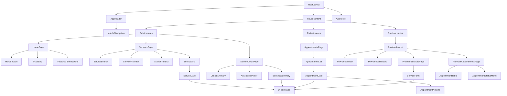

# AffordableCare Component Architecture

**Owner:** Victor Patrick (`DjPatbern`)

**Planning window:** Week 04

**Status:** Approved initial architecture

## MVP routes

| Route | Audience | Purpose | Week 04 priority |
| --- | --- | --- | --- |
| `/` | Public | Introduce AffordableCare, explain the value, and lead users into service discovery | P0 |
| `/services` | Public | Browse, search, and filter published healthcare services | P0 |
| `/services/[serviceId]` | Public | Show a service, clinic, indicative cost, location, and available appointment times | P0 |
| `/clinics/[clinicId]` | Public | Show clinic information and its published services | P1 |
| `/login` | Public | Sign in as a patient or provider | P0 |
| `/register` | Public | Create a patient account | P0 |
| `/appointments` | Patient | View upcoming, past, and cancelled appointments | P1 |
| `/appointments/[appointmentId]` | Patient | View, reschedule, or cancel one appointment | P1 |
| `/profile` | Patient | View and update permitted patient profile fields | P1 |
| `/provider` | Provider | Provider dashboard overview | P1 |
| `/provider/services` | Provider | View and manage services for authorised clinics | P1 |
| `/provider/services/new` | Provider | Create a service | P1 |
| `/provider/services/[serviceId]/edit` | Provider | Edit, publish, or unpublish a service | P1 |
| `/provider/appointments` | Provider | Review clinic appointments and update valid statuses | P1 |
| `/provider/availability` | Provider | Manage bookable service availability | P1 |

API route handlers live beside the App Router application under `/api`. The initial contracts are documented in [backend-architecture.md](backend-architecture.md).

## Reusable component inventory

### Application shell

- `AppHeader`: logo, primary navigation, authentication actions, and mobile menu.
- `AppFooter`: service links, clinic/provider links, platform disclaimer, and copyright.
- `PageContainer`: consistent maximum width and responsive horizontal gutters.
- `PageHeader`: eyebrow, title, supporting copy, and optional actions.
- `MobileNavigation`: accessible disclosure menu for narrow screens.

### Design-system primitives

- `Button`: primary, secondary, outline, ghost, and destructive variants.
- `Input`, `Select`, `Textarea`: labelled controls with hint and error states.
- `Badge`: availability, affordability, and appointment-status variants.
- `Card`: standard surface, bordered, interactive, and featured variants.
- `EmptyState`, `ErrorState`, `LoadingSkeleton`: shared async feedback.
- `Dialog` and `ConfirmDialog`: confirmation for cancellation and destructive actions.
- `Pagination`: directory and dashboard navigation.

### Service discovery

- `HeroSection`: value proposition and directory call to action.
- `TrustStrip`: short patient-focused confidence statements.
- `ServiceSearch`: keyword input and submit/reset behavior.
- `ServiceFilterBar`: category, location, and availability filters.
- `ActiveFilterList`: visible removable filters.
- `ServiceCard`: clinic, service, location, supplied cost, and availability summary.
- `ServiceGrid`: responsive results and empty/loading states.
- `ClinicSummary`: clinic identity, address, contact, and publication details.
- `AvailabilityPicker`: timezone-aware available slots.

### Authentication and patient appointments

- `AuthForm`: shared labelled field layout and form feedback.
- `AppointmentCard`: service, clinic, date/time, timezone, and status.
- `AppointmentList`: grouped upcoming/past appointment collection.
- `AppointmentActions`: contextual reschedule and cancel actions.
- `BookingSummary`: final review before appointment confirmation.

### Provider workspace

- `ProviderSidebar`: provider-only navigation and clinic context.
- `DashboardStat`: compact operational summary.
- `ServiceForm`: create/edit service fields and validation display.
- `AvailabilityForm`: timezone-aware slot input.
- `AppointmentTable`: date/status filtering and responsive row/card rendering.
- `AppointmentStatusMenu`: only valid lifecycle transitions.

## Component hierarchy

## Server and client boundaries

- Pages and layouts are Server Components by default.
- Directory results, service details, clinic data, and initial dashboard data are fetched on the server.
- Client Components are limited to interactive filters, mobile navigation, availability selection, dialogs, and forms requiring local state.
- Authorization is enforced in server-side data access and route handlers, never only through hidden controls.
- Domain types and validation schemas live outside UI components and are shared by forms, server actions, and route handlers.

## Week 04 implementation order

1. **P0 — Foundations:** design tokens, typography, `PageContainer`, `Button`, form controls, `AppHeader`, and `AppFooter`.
2. **P0 — Public discovery shell:** `/`, `/services`, `ServiceFilterBar`, `ServiceCard`, and responsive `ServiceGrid` using fixture data.
3. **P0 — Service detail shell:** `/services/[serviceId]`, `ClinicSummary`, and `AvailabilityPicker` empty/loading states.
4. **P0 — Backend foundation:** PostgreSQL schema, Prisma migration, shared types, seed data, and read-only directory APIs.
5. **P1 — Authentication shell:** `/login` and `/register`, ready to connect to the selected auth provider.
6. **P1 — Provider and appointment shells:** protected layouts and initial empty states after contracts are stable.

## Architecture rules

- Prefer feature folders when a component is route-specific; promote a component to `components/ui` or `components/shared` only after reuse is demonstrated.
- Use named domain types and validation schemas; never use `any`.
- Components receive serializable data and callbacks rather than importing database clients.
- Loading, empty, error, success, and unauthorized states are part of every feature definition.
- Every interactive control must be keyboard accessible and maintain a visible focus indicator.
